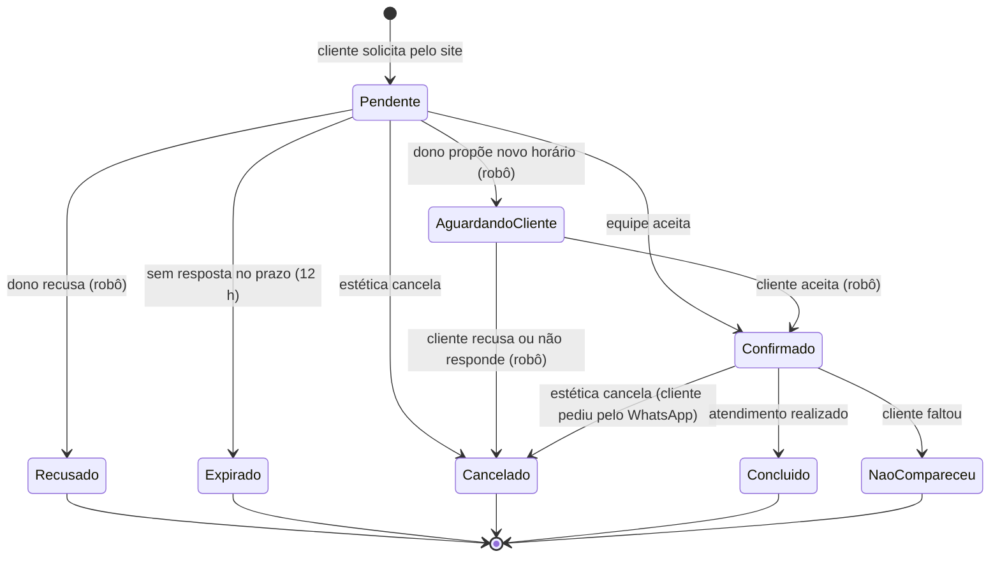
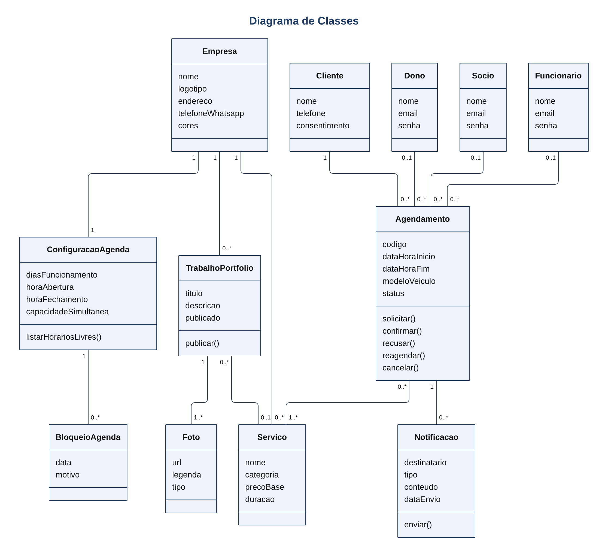

# SmartAgenda

**Vitrine e agenda online para estéticas automotivas, com confirmação de horários pelo WhatsApp.**

O SmartAgenda é uma aplicação web em Node.js que funciona ao mesmo tempo como **site institucional** da estética e como **agenda online**. O cliente escolhe os serviços e marca um horário informando apenas nome e telefone, sem precisar criar conta; para desmarcar, ele fala com a estética pelo WhatsApp. A equipe responde aos pedidos pelo painel; numa próxima etapa, um robô vai enviar cada pedido ao WhatsApp do dono, que poderá aceitar, pedir reagendamento ou recusar pela própria conversa.

A aplicação é **genérica**: nome, logotipo, cores, serviços e horários são configurados no painel administrativo, de modo que uma nova estética pode entrar em operação sem alterar código.

> **Status:** no ar. Site, agendamento, painel administrativo, banco no Supabase e publicação na Vercel funcionando. O robô do WhatsApp (RF-06 e RF-09 a RF-13) ainda não foi implementado: até lá, a equipe responde aos pedidos pelo painel, que abre a conversa no WhatsApp com a mensagem pronta. A situação de cada requisito está na seção 8 da [especificação](docs/Especificacao_Requisitos_SmartAgenda.pdf).

- **Site:** https://smartagenda-neon.vercel.app
- **Painel da equipe:** https://smartagenda-neon.vercel.app/admin/entrar.html (link "Área da equipe" no rodapé de todas as páginas)

---

## Sumário

- [Objetivos](#objetivos)
- [Funcionalidades](#funcionalidades)
- [Identidade visual](#identidade-visual)
- [Ciclo de vida de um agendamento](#ciclo-de-vida-de-um-agendamento)
- [Perfis e permissões](#perfis-e-permissões)
- [Principais regras de negócio](#principais-regras-de-negócio)
- [Requisitos não funcionais](#requisitos-não-funcionais)
- [Tecnologias](#tecnologias)
- [Modelo de domínio](#modelo-de-domínio)
- [Estrutura do projeto](#estrutura-do-projeto)
- [Primeiros passos](#primeiros-passos)
- [Documentação](#documentação)
- [Fora do escopo](#fora-do-escopo)
- [Colaboradores](#colaboradores)

---

## Objetivos

- Divulgar os serviços e os trabalhos realizados, com fotos e textos próprios.
- Permitir que o cliente agende horários pela web, sem criar conta.
- Avisar o dono pelo WhatsApp a cada novo pedido e permitir a resposta pela própria conversa.
- Confirmar o agendamento ao cliente pelo WhatsApp.
- Evitar horários em conflito, com a agenda atualizada a cada resposta.
- Restringir o painel administrativo a dono, sócios e funcionários.

## Funcionalidades

### Vitrine (site público)
- Página inicial com nome, logotipo, descrição, endereço, horário de funcionamento e contatos, uma roda 3D e o comparador de antes e depois do trabalho escolhido no painel.
- Catálogo de serviços por categoria, com descrição, preço "a partir de", duração estimada e foto opcional.
- Portfólio em galeria, com título, descrição, fotos de antes, depois e gerais, e serviço relacionado.
- Enquanto o painel não tem trabalho publicado, o site mostra trabalhos de exemplo com o selo "Exemplo" (fotos de licença livre em `public/img/fotos/`).

### Agendamento
- Calendário de horários livres, calculado pela configuração da agenda e pela duração dos serviços escolhidos.
- Solicitação de agendamento com nome, celular e, opcionalmente, modelo do veículo e observações, com consentimento da LGPD.
- Para desmarcar, o cliente fala com a estética pelo WhatsApp; a estética desmarca ou remarca pelo painel.
- Agenda atualizada a cada mudança de status, liberando horários expirados ou cancelados. Pedido sem resposta expira sozinho no prazo configurado.
- *Prevista com o robô:* validação do telefone junto ao provedor de WhatsApp antes de gravar o pedido.

### Notificações via WhatsApp (previstas, dependem do robô)
- Aviso de novo pedido ao dono com as opções **1 – Aceitar**, **2 – Reagendar**, **3 – Recusar**.
- Interpretação da resposta do dono e atualização automática do status.
- Proposta de novo horário ao cliente, registrando se ele aceita ou recusa.
- Confirmação ao cliente com data, horário, serviços, endereço e código.
- Avisos de recusa, expiração e cancelamento.

### Painel administrativo
- Login com e-mail e senha para usuários ativos.
- Gestão de usuários pelo dono: cadastrar donos, sócios e funcionários, editar, desativar e definir uma nova senha (quem esquece a senha pede ao dono).
- Pedidos pendentes: aceitar, ou chamar o cliente no WhatsApp com a mensagem pronta para combinar outro horário.
- Agenda em visão diária, semanal e mensal, com filtros por status e serviço; cada agendamento pode ser editado, remarcado ou desmarcado.
- Agendamento manual para clientes atendidos por telefone ou presencialmente.
- Registro de atendimento: **Concluído** ou **Não compareceu**.
- Cadastro de serviços (categoria, preço base, duração e foto opcional) e do portfólio (fotos de antes, depois e gerais, ordem, publicar/ocultar, comparador e destaques da página inicial).
- Configuração da agenda: dias e horários de funcionamento, intervalo entre horários, capacidade simultânea, prazos e datas bloqueadas.
- Personalização da vitrine: nome, logotipo, cor principal, descrição, endereço, contatos e número de WhatsApp das notificações.
- Relatório mensal com agendamentos por status e por serviço e valor estimado dos atendimentos concluídos, pronto para imprimir.

## Identidade visual

Site e painel usam o mesmo tema escuro: preto azulado, cromo e azul elétrico. A cor principal configurada no painel substitui o azul (cores quase pretas são ignoradas, porque sumiriam no fundo).

- **Fonte:** [Archivo](https://fonts.google.com/specimen/Archivo), uma família variável em peso e largura, guardada no projeto (`public/fontes/`, licença SIL OFL). Títulos na largura expandida, texto na largura normal.
- **Roda 3D:** desenhada em código com [Three.js](https://threejs.org/) (`public/js/aro3d-cena.js`), sem modelo baixado. Gira devagar, inclina com o mouse e pode ser girada arrastando. Em aparelho fraco, sem WebGL ou com economia de dados, aparece uma imagem da mesma roda (`public/img/aro-3d.webp`).
- **Movimento reduzido:** se o sistema pede menos movimento (no Windows, *Efeitos de animação* desligados), a roda gira mais devagar e o parallax e as animações de entrada ficam desligados.
- **Folhas de estilo:** `tokens.css` e `site.css` são a base; `tema.css` aplica o tema escuro ao site e ao painel; `painel-tema.css` ajusta as telas do painel.

## Ciclo de vida de um agendamento



Status possíveis: Pendente, Aguardando cliente, Confirmado, Recusado, Expirado, Cancelado, Concluído e Não compareceu. Os status **Aguardando cliente** e **Recusado** fazem parte do fluxo do robô do WhatsApp; pelo painel, a equipe aceita, remarca ou desmarca.

## Perfis e permissões

| Ação | Dono | Sócio | Funcionário |
|---|:---:|:---:|:---:|
| Ver agenda, responder pedidos, registrar atendimento | ✅ | ✅ | ✅ |
| Criar agendamento manual | ✅ | ✅ | ✅ |
| Gerenciar portfólio | ✅ | ✅ | ✅ |
| Gerenciar serviços | ✅ | ✅ | ❌ |
| Gerar relatório mensal | ✅ | ✅ | ❌ |
| Configurar agenda e vitrine | ✅ | ❌ | ❌ |
| Gerenciar usuários | ✅ | ❌ | ❌ |

O **cliente** não tem login: acessa apenas o site público (vitrine e agendamento).

## Principais regras de negócio

| Regra | Descrição |
|---|---|
| Dados mínimos | Nome (mínimo 3 caracteres) e celular com DDD. A verificação de que o número usa WhatsApp virá com o robô. |
| Cliente único | Um cliente por telefone; novos pedidos do mesmo número são vinculados a ele. |
| Duração | Tempo reservado = soma das durações dos serviços, terminando até o fechamento. |
| Capacidade | Pendentes + confirmados no mesmo intervalo não excedem a capacidade configurada. |
| Antecedência | Mínimo de 2 horas e máximo de 30 dias (configurável). |
| Prazo de resposta | Pedido pendente sem resposta em 12 horas expira e libera o horário (configurável). |
| Limite por telefone | Máximo de 2 agendamentos ativos por telefone. |
| Cancelamento | O cliente pede pelo WhatsApp; a estética cancela ou remarca pelo painel. |
| Preço | O valor da vitrine é "a partir de"; o final é definido após avaliar o veículo. |
| Usuários | Somente o dono gerencia usuários, e sempre deve existir ao menos um dono ativo. |

A lista completa (RN-01 a RN-16) está na [especificação de requisitos](docs/Especificacao_Requisitos_SmartAgenda.pdf).

## Requisitos não funcionais

Metas da especificação. O que já foi cumprido, o que depende do robô ou da hospedagem e o que ainda não foi medido estão na seção 8 da [especificação](docs/Especificacao_Requisitos_SmartAgenda.pdf).

- **Desempenho:** páginas públicas em até 3 s no 4G; consulta de horários em até 2 s; 50 usuários simultâneos.
- **Notificação (com o robô):** mensagem ao dono em até 30 s em pelo menos 95% dos casos.
- **Disponibilidade:** 99% do tempo de cada mês; backup diário mantido por 7 dias.
- **Usabilidade:** agendamento concluído em até 2 minutos e no máximo 4 telas; layout responsivo de 360 px a 1920 px.
- **Segurança:** HTTPS em todas as páginas; senhas com hash bcrypt; sessão do painel expira após 30 minutos sem uso.
- **Imagens:** upload em JPG, PNG ou WebP de até 5 MB, redimensionadas para no máximo 1600 px no maior lado.
- **LGPD:** coleta de nome e telefone só com consentimento explícito; anonimização de clientes sem agendamento há 12 meses.
- **Resiliência do WhatsApp (com o robô):** API autorizada; se o serviço estiver fora do ar, o agendamento pelo site continua funcionando e as mensagens pendentes são reenviadas.

## Tecnologias

| Camada | Tecnologia |
|---|---|
| Back-end | [Node.js](https://nodejs.org/) 22+ + [Express 5](https://expressjs.com/) |
| Front-end | HTML, CSS e JavaScript sem framework; [Three.js](https://threejs.org/) para a roda 3D |
| Banco de dados | [Supabase](https://supabase.com/) (PostgreSQL), com funções SQL e rotinas no pg_cron |
| Armazenamento de fotos | Supabase Storage |
| Hospedagem | [Vercel](https://vercel.com/) (páginas estáticas + API como função) |
| Mensageria | API autorizada de WhatsApp (prevista) |
| Segurança | bcrypt para senhas, sessão em cookie assinado, Helmet (CSP), limite de tentativas, HTTPS |
| Testes | `node --test`; testes de SQL com [PGlite](https://pglite.dev/) quando instalado |

## Modelo de domínio



Principais classes: `Empresa`, `ConfiguracaoAgenda`, `BloqueioAgenda`, `Servico`, `TrabalhoPortfolio`, `Foto`, `Cliente`, `Agendamento`, `ItemAgendamento`, `Notificacao` e a hierarquia `UsuarioAdmin` → `Dono`, `Socio`, `Funcionario`. A UML técnica completa, com visibilidade, tipos e assinaturas de métodos, está em [docs/uml-tecnica.png](docs/uml-tecnica.png).

## Estrutura do projeto

```
api/index.js              # entrada da API na Vercel
public/                   # site e painel (páginas, CSS, JS, fontes, imagens)
├── admin/                # telas do painel da equipe
├── css/                  # tokens.css, site.css, tema.css, painel-tema.css e folhas de cada tela
├── js/                   # scripts do site; js/admin/ para o painel
├── fontes/               # Archivo (woff2)
├── img/fotos/            # fotos dos trabalhos de exemplo (CC0, ver CREDITOS.txt)
└── vendor/three/         # Three.js
scripts/criar-dono.js     # cria a empresa e o primeiro acesso ao painel
src/                      # servidor Express: rotas, domínio, repositórios, sessão
supabase/migrations/      # esquema do banco, funções SQL, rotinas e bucket de fotos
test/                     # testes automatizados
vercel.json               # rotas, cabeçalhos de segurança e cache
```

## Primeiros passos

### Pré-requisitos

- Node.js 22 ou mais novo e npm
- Um projeto no Supabase (o bucket de fotos é criado pelas migrações)

### Instalação

```bash
git clone <url-do-repositorio> smartagenda
cd smartagenda
npm install
cp .env.example .env   # preencha as variáveis (o .env nunca vai para o Git)
npx supabase db push --remote=<id-do-projeto>   # aplica supabase/migrations no banco
npm run criar-dono     # uma vez: cria a empresa e o primeiro acesso ao painel
npm run dev            # site em http://localhost:3000, painel em /admin/entrar.html
```

Testes: `npm test`.

### Variáveis de ambiente

Conforme o RNF-12, uma nova estética entra em operação alterando apenas dados no painel e variáveis de ambiente:

| Variável | Uso |
|---|---|
| `SESSION_SECRET` | Segredo para assinar a sessão do painel (pelo menos 32 caracteres em produção) |
| `SUPABASE_URL` | URL do projeto Supabase |
| `SUPABASE_SERVICE_KEY` | Chave de serviço do Supabase (somente no servidor) |
| `SUPABASE_BUCKET` | Bucket do Storage para as fotos (`portfolio`) |
| `FUSO_HORARIO` | Fuso da estética, por exemplo `America/Sao_Paulo` |
| `NODE_ENV` | `production` no servidor publicado |
| `PORT` | Porta do servidor HTTP (só local) |
| `WHATSAPP_API_URL` | Endereço da API de WhatsApp (robô, ainda não usado) |
| `WHATSAPP_API_TOKEN` | Token de acesso à API de WhatsApp (robô, ainda não usado) |

### Publicação na Vercel

O projeto já vem configurado (`vercel.json` e `api/index.js`): as páginas saem de `public/` e as rotas `/api` rodam como função. Basta importar o repositório na Vercel com o preset **Other** e cadastrar as variáveis acima em *Settings > Environment Variables*.

Sem a integração com o GitHub, publique pela linha de comando:

```bash
npx vercel login          # uma vez
npx vercel deploy --prod  # publica o que está na pasta
```

### Banco de dados

Mudanças no banco vão em arquivos novos em `supabase/migrations/` e são aplicadas com `npx supabase db push --remote=<id-do-projeto>`. Para ver quais já estão no banco: `npx supabase migration list --remote=<id-do-projeto>`.

## Documentação

```
docs/
├── Especificacao_Requisitos_SmartAgenda.pdf   # especificação de requisitos completa
├── diagrama-classes.png                       # diagrama de classes do domínio
├── uml-tecnica.png                            # UML técnica de projeto
└── fonte/
    └── especificacao.html                     # fonte editável da especificação
```

- [Especificação de Requisitos (PDF)](docs/Especificacao_Requisitos_SmartAgenda.pdf), versão 1.1 (16/11/2026): visão geral, 24 requisitos funcionais, 14 não funcionais, 16 regras de negócio, matriz de permissões, diagramas UML, decisões tomadas no desenvolvimento (seção 7) e situação de cada requisito na entrega (seção 8).

Para regenerar o PDF depois de editar `docs/fonte/especificacao.html`, abra o arquivo no Chrome ou no Edge, use **Imprimir > Salvar como PDF** (margens padrão, com gráficos de fundo) e salve por cima de `docs/Especificacao_Requisitos_SmartAgenda.pdf`. O [WeasyPrint](https://weasyprint.org/) também funciona:

```bash
weasyprint docs/fonte/especificacao.html docs/Especificacao_Requisitos_SmartAgenda.pdf
```

## Fora do escopo

Nesta versão não estão previstos: pagamento online, nota fiscal, login de clientes, aplicativo nativo e controle financeiro ou de estoque.

## Colaboradores

- **Humberto Pereira Gomes**
- **Gabriel Nascimento Botelho**