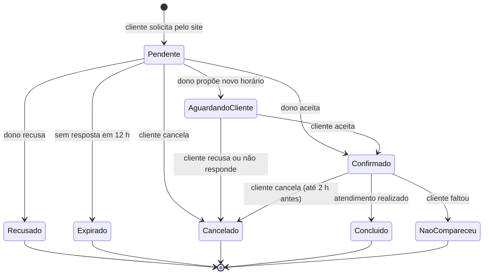
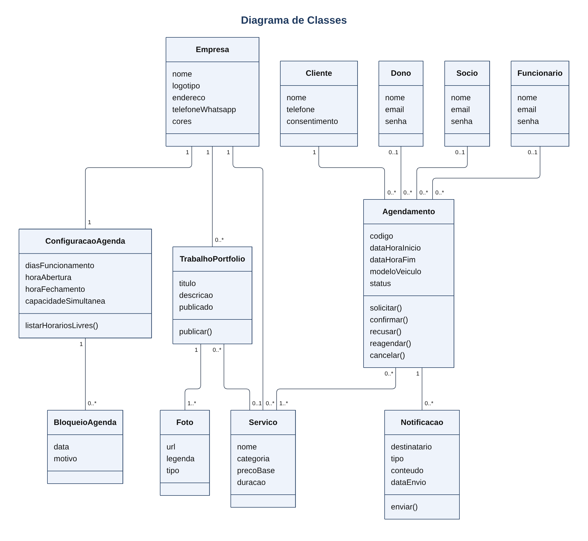

# SmartAgenda

**Vitrine e agenda online para estéticas automotivas, com confirmação de horários pelo WhatsApp.**

O SmartAgenda é uma aplicação web em Node.js que funciona ao mesmo tempo como **site institucional** da estética e como **agenda online**. O cliente escolhe os serviços e marca ou desmarca um horário informando apenas nome e telefone, sem precisar criar conta. Cada pedido é enviado por um robô ao WhatsApp do dono, que aceita, pede reagendamento ou recusa pela própria conversa.

A aplicação é **genérica**: nome, logotipo, cores, serviços e horários são configurados no painel administrativo, de modo que uma nova estética pode entrar em operação sem alterar código.

> **Status:** em especificação (versão 1.0 dos requisitos, 04/11/2026).

---

## Sumário

- [Objetivos](#objetivos)
- [Funcionalidades](#funcionalidades)
- [Ciclo de vida de um agendamento](#ciclo-de-vida-de-um-agendamento)
- [Perfis e permissões](#perfis-e-permissões)
- [Principais regras de negócio](#principais-regras-de-negócio)
- [Requisitos não funcionais](#requisitos-não-funcionais)
- [Tecnologias](#tecnologias)
- [Modelo de domínio](#modelo-de-domínio)
- [Primeiros passos](#primeiros-passos)
- [Documentação](#documentação)
- [Fora do escopo](#fora-do-escopo)
- [Colaboradores](#colaboradores)

---

## Objetivos

- Divulgar os serviços e os trabalhos realizados, com fotos e textos próprios.
- Permitir que o cliente agende e cancele horários pela web, sem criar conta.
- Avisar o dono pelo WhatsApp a cada novo pedido e permitir a resposta pela própria conversa.
- Confirmar o agendamento ao cliente pelo WhatsApp.
- Evitar horários em conflito, com a agenda atualizada a cada resposta.
- Restringir o painel administrativo a dono, sócios e funcionários.

## Funcionalidades

### Vitrine (site público)
- Página inicial com nome, logotipo, descrição, endereço, horário de funcionamento e contatos.
- Catálogo de serviços por categoria, com descrição, preço "a partir de" e duração estimada.
- Portfólio em galeria, com título, descrição, fotos e serviço relacionado.

### Agendamento
- Calendário de horários livres, calculado pela configuração da agenda e pela duração dos serviços escolhidos.
- Solicitação de agendamento com nome, telefone e, opcionalmente, modelo do veículo e observações.
- Validação do telefone junto ao provedor de WhatsApp antes de gravar o pedido.
- Cancelamento pelo cliente informando telefone e código do agendamento.
- Agenda atualizada a cada mudança de status, liberando horários recusados, expirados ou cancelados.

### Notificações via WhatsApp
- Aviso de novo pedido ao dono com as opções **1 – Aceitar**, **2 – Reagendar**, **3 – Recusar**.
- Interpretação da resposta do dono e atualização automática do status.
- Proposta de novo horário ao cliente, registrando se ele aceita ou recusa.
- Confirmação ao cliente com data, horário, serviços, endereço e código.
- Avisos de recusa, expiração e cancelamento.

### Painel administrativo
- Login com e-mail e senha para usuários ativos.
- Gestão de usuários (sócios e funcionários) pelo dono.
- Resposta a pedidos pendentes também pelo painel.
- Agenda em visão diária, semanal e mensal, com filtros por status e serviço.
- Agendamento manual para clientes atendidos por telefone ou presencialmente.
- Registro de atendimento: **Concluído** ou **Não compareceu**.
- Cadastro de serviços (categoria, preço base, duração) e do portfólio (fotos, ordem, publicar/ocultar).
- Configuração da agenda: dias e horários de funcionamento, intervalo entre horários, capacidade simultânea, prazos e datas bloqueadas.
- Personalização da vitrine: nome, logotipo, cores, descrição, endereço, contatos e número de WhatsApp das notificações.
- Relatório mensal com agendamentos por status e por serviço e valor estimado dos atendimentos concluídos.

## Ciclo de vida de um agendamento



Status possíveis: Pendente, Aguardando cliente, Confirmado, Recusado, Expirado, Cancelado, Concluído e Não compareceu.

## Perfis e permissões

| Ação | Dono | Sócio | Funcionário |
|---|:---:|:---:|:---:|
| Ver agenda, responder pedidos, registrar atendimento | ✅ | ✅ | ✅ |
| Criar agendamento manual | ✅ | ✅ | ✅ |
| Gerenciar portfólio | ✅ | ✅ | ✅ |
| Gerenciar serviços | ✅ | ✅ | ❌ |
| Gerar relatório mensal | ✅ | ✅ | ❌ |
| Configurar agenda e vitrine | ✅ | ❌ | ❌ |
| Gerenciar usuários | ✅ | ❌ | ❌ |

O **cliente** não tem login: acessa apenas o site público (vitrine, agendamento e cancelamento).

## Principais regras de negócio

| Regra | Descrição |
|---|---|
| Dados mínimos | Nome (mínimo 3 caracteres) e celular com DDD, ativo no WhatsApp. |
| Cliente único | Um cliente por telefone; novos pedidos do mesmo número são vinculados a ele. |
| Duração | Tempo reservado = soma das durações dos serviços, terminando até o fechamento. |
| Capacidade | Pendentes + confirmados no mesmo intervalo não excedem a capacidade configurada. |
| Antecedência | Mínimo de 2 horas e máximo de 30 dias (configurável). |
| Prazo de resposta | Pedido pendente sem resposta em 12 horas expira e libera o horário (configurável). |
| Limite por telefone | Máximo de 2 agendamentos ativos por telefone. |
| Cancelamento | Pelo cliente, até 2 horas antes do horário (configurável). |
| Preço | O valor da vitrine é "a partir de"; o final é definido após avaliar o veículo. |
| Usuários | Somente o dono gerencia usuários, e sempre deve existir ao menos um dono ativo. |

A lista completa (RN-01 a RN-16) está na [especificação de requisitos](docs/Especificacao_Requisitos_SmartAgenda.pdf).

## Requisitos não funcionais

- **Desempenho:** páginas públicas em até 3 s no 4G; consulta de horários em até 2 s; 50 usuários simultâneos.
- **Notificação:** mensagem ao dono em até 30 s em pelo menos 95% dos casos.
- **Disponibilidade:** 99% do tempo de cada mês; backup diário mantido por 7 dias.
- **Usabilidade:** agendamento concluído em até 2 minutos e no máximo 4 telas; layout responsivo de 360 px a 1920 px.
- **Segurança:** HTTPS em todas as páginas; senhas com hash bcrypt; sessão do painel expira após 30 minutos sem uso.
- **Imagens:** upload em JPG, PNG ou WebP de até 5 MB, redimensionadas para no máximo 1600 px no maior lado.
- **LGPD:** coleta de nome e telefone só com consentimento explícito; anonimização de clientes sem agendamento há 12 meses.
- **Resiliência do WhatsApp:** API autorizada; se o serviço estiver fora do ar, o agendamento pelo site continua funcionando e as mensagens pendentes são reenviadas.

## Tecnologias

| Camada | Tecnologia |
|---|---|
| Back-end | [Node.js](https://nodejs.org/) (LTS) + [Express](https://expressjs.com/) |
| Banco de dados | [Supabase](https://supabase.com/) (PostgreSQL) |
| Armazenamento de fotos | Supabase Storage |
| Mensageria | API autorizada de WhatsApp |
| Segurança | bcrypt para senhas, HTTPS |

## Modelo de domínio



Principais classes: `Empresa`, `ConfiguracaoAgenda`, `BloqueioAgenda`, `Servico`, `TrabalhoPortfolio`, `Foto`, `Cliente`, `Agendamento`, `ItemAgendamento`, `Notificacao` e a hierarquia `UsuarioAdmin` → `Dono`, `Socio`, `Funcionario`. A UML técnica completa, com visibilidade, tipos e assinaturas de métodos, está em [docs/uml-tecnica.png](docs/uml-tecnica.png).

## Primeiros passos

> Os comandos abaixo seguem o padrão de um projeto Node.js/Express e servem de guia enquanto o código é desenvolvido. Ajuste-os conforme o projeto evoluir.

### Pré-requisitos

- Node.js (versão LTS) e npm
- Um projeto no Supabase (banco PostgreSQL e um bucket no Storage para as fotos)
- Acesso a uma API autorizada de WhatsApp

### Instalação

```bash
git clone <url-do-repositorio> smartagenda
cd smartagenda
npm install
cp .env.example .env   # preencha as variáveis
npm run dev
```

### Variáveis de ambiente (sugestão)

Conforme o RNF-12, uma nova estética entra em operação alterando apenas dados no painel e variáveis de ambiente:

| Variável | Uso |
|---|---|
| `PORT` | Porta do servidor HTTP |
| `SUPABASE_URL` | URL do projeto Supabase |
| `SUPABASE_SERVICE_KEY` | Chave de serviço do Supabase (somente no servidor) |
| `SUPABASE_BUCKET` | Bucket do Storage para as fotos do portfólio |
| `WHATSAPP_API_URL` | Endereço da API de WhatsApp |
| `WHATSAPP_API_TOKEN` | Token de acesso à API de WhatsApp |
| `SESSION_SECRET` | Segredo para assinar a sessão do painel |

## Documentação

```
docs/
├── Especificacao_Requisitos_SmartAgenda.pdf   # especificação de requisitos completa
├── diagrama-classes.png                       # diagrama de classes do domínio
├── uml-tecnica.png                            # UML técnica de projeto
└── fonte/
    └── especificacao.html                     # fonte editável da especificação
```

- [Especificação de Requisitos (PDF)](docs/Especificacao_Requisitos_SmartAgenda.pdf): visão geral, 24 requisitos funcionais, 14 não funcionais, 16 regras de negócio, matriz de permissões e diagramas UML.

Para regenerar o PDF depois de editar `docs/fonte/especificacao.html`, use o [WeasyPrint](https://weasyprint.org/) com a fonte [Inter](https://rsms.me/inter/) instalada:

```bash
weasyprint docs/fonte/especificacao.html docs/Especificacao_Requisitos_SmartAgenda.pdf
```

## Fora do escopo

Nesta versão não estão previstos: pagamento online, nota fiscal, login de clientes, aplicativo nativo e controle financeiro ou de estoque.

## Colaboradores

- **Humberto Pereira Gomes**
- **Gabriel Nascimento Botelho**